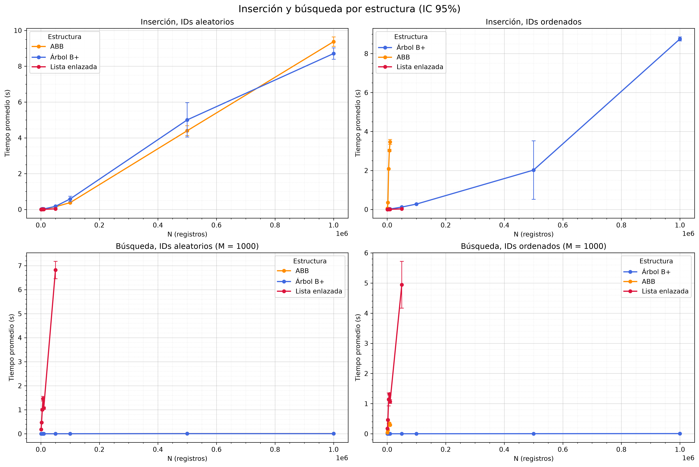
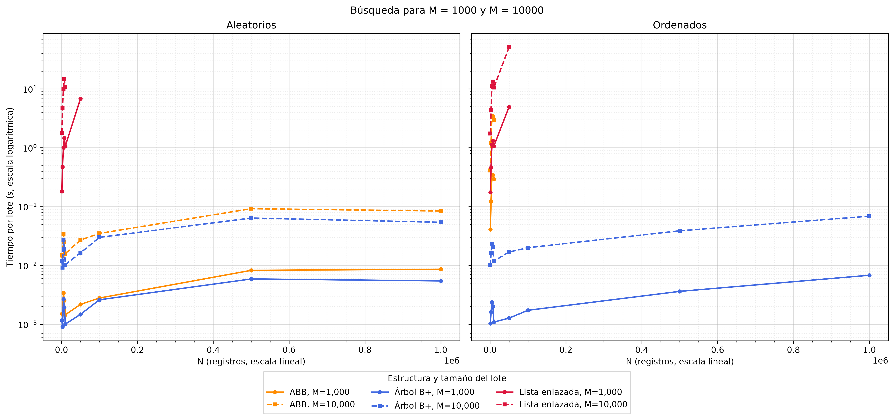
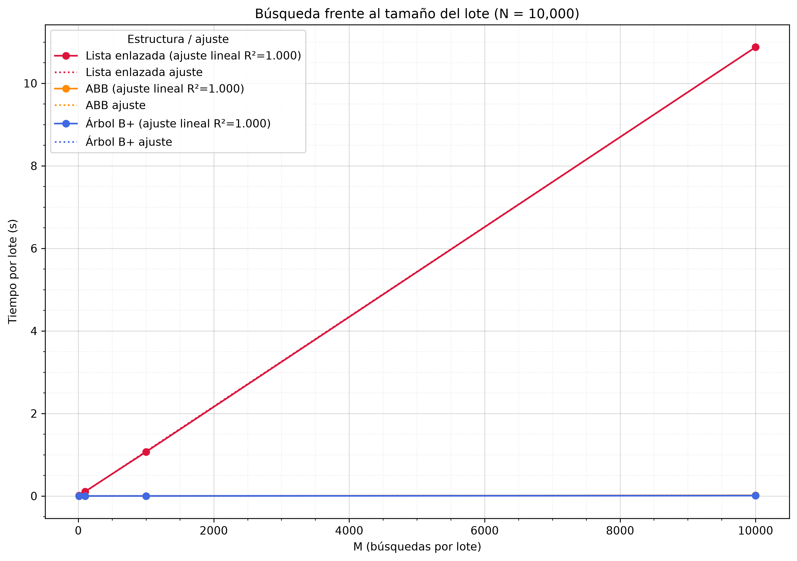
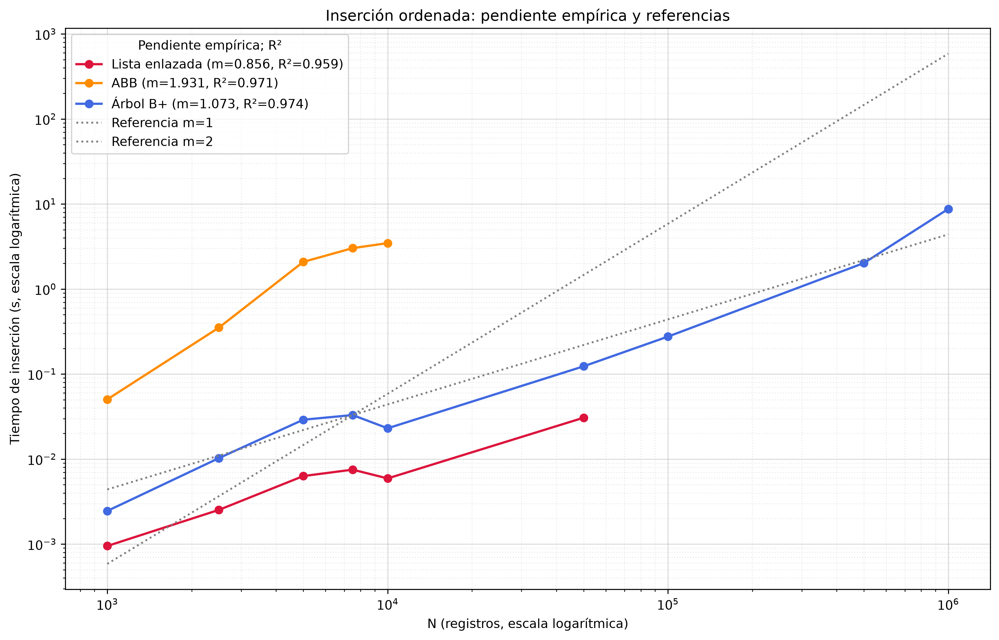
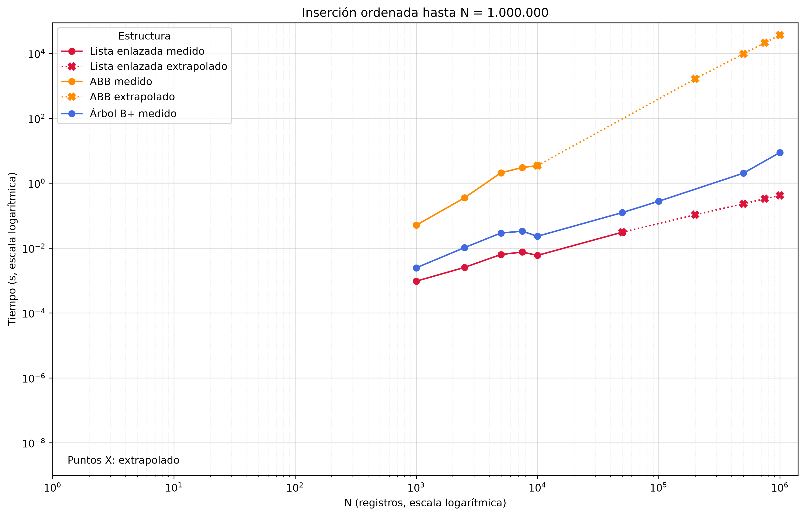
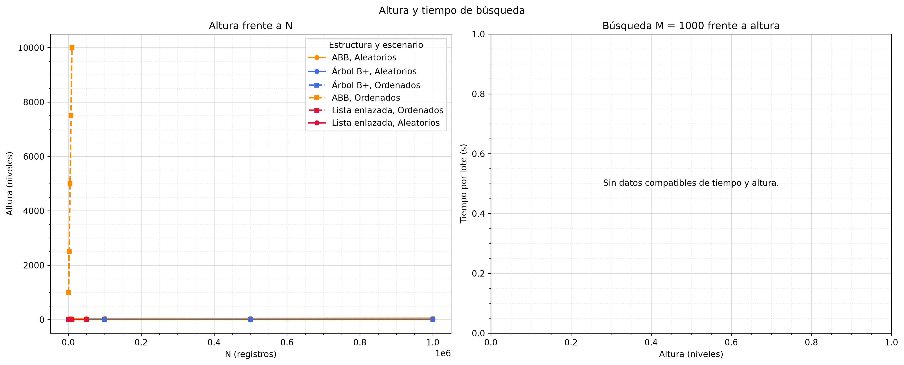
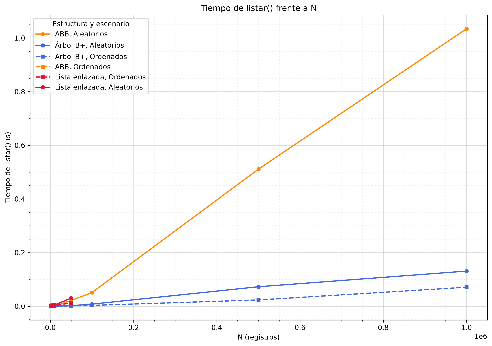
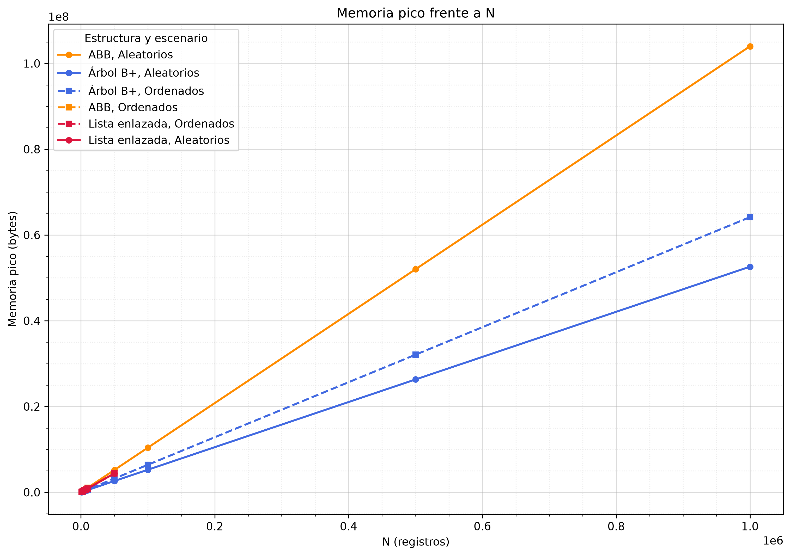
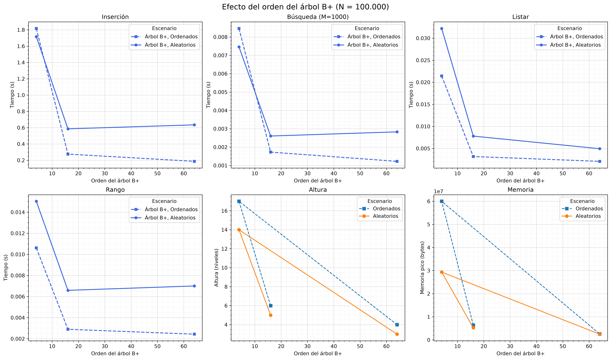

# Laboratorio 3: estructuras de datos y búsqueda de estudiantes

## Problema y objetivo

El laboratorio compara cómo se comportan tres estructuras al guardar registros
de estudiantes y buscar por ID. El problema es determinar cómo influyen el
tamaño de los datos y el orden de inserción en los tiempos, la altura, el
recorrido y el uso de memoria.

El objetivo es medir, bajo las mismas cargas, una lista enlazada, un árbol
binario de búsqueda sin balanceo (ABB) y un árbol B+. Se consideran inserciones
con IDs aleatorios y en orden ascendente, lotes de búsquedas existentes,
búsquedas inexistentes, listado, altura, memoria y consultas por rango.

## Terminología y estructuras

- **N**: cantidad de registros.
- **M**: cantidad de búsquedas por lote. No es el orden del árbol.
- **K**: cantidad de repeticiones independientes que indica el CSV para cada
  configuración.
- **Orden del B+**: el benchmark principal usa orden **16**. El barrido
  adicional compara los órdenes **4, 16 y 64**.
- **Modo**: orden de inserción de los IDs; no es el orden de las consultas.

| Estructura | Inserción individual | Construcción | Búsqueda | Recorrido ordenado |
| --- | --- | --- | --- | --- |
| Lista enlazada | \(O(1)\) al final | \(O(N)\) | \(O(N)\) | \(O(N\log N)\) con `listar()` |
| ABB, caso equilibrado | \(O(\log N)\) | \(O(N\log N)\) | \(O(\log N)\) | \(O(N)\) |
| ABB, IDs ordenados | hasta \(O(N)\) | \(O(N^2)\) | hasta \(O(N)\) | \(O(N)\) |
| Árbol B+, orden fijo 16 | \(O(\log N)\) | \(O(N\log N)\) | \(O(\log N)\) | \(O(N)\) |

El ABB no se balancea automáticamente: con IDs ascendentes puede degenerar en
una cadena. La complejidad equilibrada del ABB describe el caso promedio, no
una garantía del código. El árbol B+ mantiene una estructura multinivel y
enlaza sus hojas para recorrerlas en orden.

## Hardware y software

Datos leídos de [`resultados/ficha.json`](resultados/ficha.json):

| Propiedad | Valor registrado |
| --- | --- |
| CPU | Intel64 Family 6 Model 186 Stepping 2, GenuineIntel |
| Núcleos lógicos | 12 |
| Memoria física | 16,869,351,424 bytes |
| Sistema operativo | Windows-10-10.0.26200-SP0 |
| Python | CPython 3.11.9, 64-bit |
| NumPy | 2.4.6 |
| pandas | 3.0.6 |
| Matplotlib | 3.11.2 |
| Seaborn | 0.13.2 |
| Semilla | 2026 |

## Parámetros y límites de viabilidad

El conjunto de tamaños configurado es
\(N \in \{1.000,\ 2.500,\ 5.000,\ 7.500,\ 10.000,\ 50.000,\ 100.000,\
500.000,\ 1.000.000\}\). Los lotes de búsqueda son
\(M \in \{10,\ 100,\ 1.000,\ 10.000\}\). Estos tamaños y lotes aparecen en los
CSV de resultados.

El CSV registra \(K=10\) hasta \(N=10.000\), \(K=5\) para los tamaños
intermedios y \(K=3\) para los tamaños mayores. Para el ABB ordenado en el
límite \(N=100.000\), registra \(K=3\). Se reduce el número de repeticiones en
las configuraciones costosas para contener el tiempo de ejecución; el ABB
ordenado puede requerir \(O(N^2)\) operaciones.

Límites del benchmark:

- ABB con IDs ordenados: viable solo hasta \(N=100.000\). Aun dentro de ese
  límite, una configuración puede superar el timeout y quedar como **no
  medido**, como ocurrió en los resultados de ese tamaño.
- Lista enlazada con \(N \ge 500.000\): búsquedas existentes limitadas a
  \(M \le 1.000\). Para los tamaños grandes, las pruebas de memoria se reservan
  al árbol B+ y al ABB con IDs aleatorios.
- Una configuración que supera el timeout de 600 segundos se aborta y aparece
  como **no medido**. Los límites o el timeout no se reemplazan con valores
  estimados.

## Generación de datos y búsquedas

Para cada tamaño se generan IDs en orden ascendente o en una permutación
aleatoria. Los registros comparten los mismos campos y las búsquedas existentes
usan IDs aleatorios del conjunto generado. Las consultas se ejecutan en lotes
de tamaño M. Las búsquedas inexistentes usan IDs fuera del intervalo de IDs
almacenados.

La construcción y validación preceden al cronómetro de las operaciones de
búsqueda, listado, altura y rango. Se comprueba que `listar()` devuelve los IDs
en orden y que las consultas de validación encuentran los registros esperados.
La memoria se mide aparte durante una construcción; no se repite por cada K.

## Método de medición, estadística y atípicos

- Se usa `time.perf_counter()` y se desactiva temporalmente el recolector de
  basura durante la ventana cronometrada.
- Las operaciones rápidas se repiten dentro de una ventana para obtener su
  tiempo medio. Los CSV crudos registran la muestra, la duración de la ventana
  y el número de repeticiones internas.
- La memoria es el pico de asignaciones Python observado con `tracemalloc` y se
  expresa en bytes. No equivale al uso total de memoria del proceso.
- El resumen calcula media, desviación estándar muestral e intervalo de
  confianza del 95%. Detecta atípicos con la regla IQR, pero no los elimina de
  la media principal; también guarda la media sin atípicos.
- **No medido** significa que no existe una medición válida para esa
  configuración. No se interpreta como cero ni como una estimación.

## Resultados reales

Las siguientes cifras son medias y desviaciones muestrales del archivo
[`resultados/resultados_benchmark.csv`](resultados/resultados_benchmark.csv).
Los tiempos están en segundos; las búsquedas mostradas son lotes completos.
La altura es el promedio registrado y la memoria está en bytes. «no medido»
indica que el CSV no contiene una medición válida.

### N = 10.000

| Modo | Estructura | K | Inserción (s) | Búsqueda M=1.000 (s) | Búsqueda M=10.000 (s) | Listar (s) | Altura | Memoria (bytes) |
| --- | --- | ---: | ---: | ---: | ---: | ---: | ---: | ---: |
| IDs aleatorios | Lista enlazada | 10 | 0.005733 ± 0.000448 | 1.06894 ± 0.063997 | 10.8744 ± 0.261 | 0.004667 ± 0.000261 | 1 | 880,208 |
| IDs aleatorios | ABB | 10 | 0.02004 ± 0.00155 | 0.001447 ± 0.00011 | 0.01588 ± 0.000994 | 0.002015 ± 0.000143 | 31.1 | 1,040,200 |
| IDs aleatorios | Árbol B+ | 10 | 0.02693 ± 0.00089 | 0.001005 ± 0.0000662 | 0.01032 ± 0.000786 | 0.0001805 ± 0.0000168 | 4 | 522,992 |
| IDs ordenados | Lista enlazada | 10 | 0.005925 ± 0.000632 | 1.06717 ± 0.084792 | 10.5394 ± 0.368575 | 0.002407 ± 0.000144 | 1 | 880,208 |
| IDs ordenados | ABB | 10 | 3.46737 ± 0.174444 | 0.292991 ± 0.036483 | 2.969755 ± 0.204643 | 0.004404 ± 0.000471 | 10.000 | 1,040,416 |
| IDs ordenados | Árbol B+ | 10 | 0.02304 ± 0.00119 | 0.001089 ± 0.000099 | 0.01184 ± 0.00105 | 0.0001884 ± 0.0000201 | 5 | 637,448 |

### N = 100.000

| Modo | Estructura | K | Inserción (s) | Búsqueda M=1.000 (s) | Búsqueda M=10.000 (s) | Listar (s) | Altura | Memoria (bytes) |
| --- | --- | ---: | ---: | ---: | ---: | ---: | ---: | ---: |
| IDs aleatorios | Lista enlazada | 5 | no medido | no medido | no medido | no medido | no medido | no medido |
| IDs aleatorios | ABB | 5 | 0.379591 ± 0.0147 | 0.00279026 ± 0.000171 | 0.0349771 ± 0.00195 | 0.0509152 ± 0.00268 | 40.6 | 10,400,400 |
| IDs aleatorios | Árbol B+ | 5 | 0.585853 ± 0.208 | 0.00260478 ± 0.00103 | 0.0299919 ± 0.00922 | 0.00779753 ± 0.00172 | 5 | 5,253,432 |
| IDs ordenados | Lista enlazada | 5 | no medido | no medido | no medido | no medido | no medido | no medido |
| IDs ordenados | ABB | 3 | no medido | no medido | no medido | no medido | no medido | no medido |
| IDs ordenados | Árbol B+ | 5 | 0.275896 ± 0.027 | 0.00172731 ± 0.000241 | 0.0200016 ± 0.00155 | 0.00316382 ± 0.000405 | 6 | 6,412,016 |

### N = 1.000.000

| Modo | Estructura | K | Inserción (s) | Búsqueda M=1.000 (s) | Búsqueda M=10.000 (s) | Listar (s) | Altura | Memoria (bytes) |
| --- | --- | ---: | ---: | ---: | ---: | ---: | ---: | ---: |
| IDs aleatorios | Lista enlazada | 3 | no medido | no medido | no medido | no medido | no medido | no medido |
| IDs aleatorios | ABB | 3 | 9.37374 ± 0.106 | 0.00861353 ± 0.000311 | 0.0840923 ± 0.00291 | 1.03436 ± 0.183 | 49.333 | 104,000,416 |
| IDs aleatorios | Árbol B+ | 3 | 8.70833 ± 0.128 | 0.00545478 ± 0.000162 | 0.0540715 ± 0.00118 | 0.130942 ± 0.0135 | 6 | 52,605,656 |
| IDs ordenados | Lista enlazada | 3 | no medido | no medido | no medido | no medido | no medido | no medido |
| IDs ordenados | ABB | 3 | no medido | no medido | no medido | no medido | no medido | no medido |
| IDs ordenados | Árbol B+ | 3 | 8.75048 ± 0.0416 | 0.00679678 ± 0.0000238 | 0.0686844 ± 0.00145 | 0.0707955 ± 0.00325 | 7 | 64,159,184 |

Los registros de orden B+ distintos al orden 16 pertenecen al barrido
adicional. Los resultados adicionales, incluidos búsquedas inexistentes,
rangos y desviaciones, están en el CSV de resumen; cada medición individual
está en [`resultados/resultados_crudos.csv`](resultados/resultados_crudos.csv).
El listado de resultados por tamaño se encuentra en
[`resultados/tabla_N.md`](resultados/tabla_N.md).

## Tablas y gráficas

### Matriz comparativa



### Búsquedas por lote





### Inserción y extrapolación





El gráfico de extrapolación distingue sus proyecciones de los puntos medidos.
Una proyección no es un resultado de ejecución: su valor es **no medido** en
los CSV. La tabla anterior reporta para el tamaño mayor solamente las
configuraciones que sí están registradas como medidas.

### Altura, listado, memoria y orden B+









## Respuestas a siete preguntas de análisis

### ¿Cómo afecta el orden de inserción al ABB?

En el resultado de tamaño 10.000, la altura promedio del ABB pasa de 31.1 con
IDs aleatorios a 10.000 con IDs ordenados. Su tiempo de inserción registrado
pasa de 0.02004 s a 3.46737 s. Los datos muestran la degeneración de este ABB
sin balanceo.

### ¿Cuándo deja el ABB de comportarse como \(O(\log N)\)?

La búsqueda deja de tener altura logarítmica cuando el árbol se degenera y
requiere recorrer un camino proporcional a N. En el resultado de tamaño 10.000,
la búsqueda del ABB ordenado tiene altura 10.000; el de IDs aleatorios tiene
altura 31.1. Para el ABB ordenado de tamaño 100.000, los tiempos son **no
medido**.

### ¿Qué relación hay entre altura y tiempo de búsqueda?

El costo de una búsqueda en el ABB depende de los nodos del camino y, por ello,
de su altura. En el resultado de tamaño 10.000, para lotes de 1.000 búsquedas,
el ABB aleatorio registra 0.001447 s y el ABB ordenado 0.292991 s, junto con
alturas de 31.1 y 10.000, respectivamente. Son medidas de esas configuraciones,
no una relación causal aislada de otros factores.

### ¿Cómo cambia el tiempo al aumentar M?

Para la lista enlazada con IDs aleatorios y tamaño 10.000, el lote M=1.000 tarda
1.06894 s y el lote M=10.000 tarda 10.8744 s. Para el árbol B+ bajo el mismo
tamaño y modo, esos lotes tardan 0.001005 s y 0.01032 s. Los CSV permiten
contrastar el costo de ampliar el lote entre estructuras.

### ¿Qué estructura registra menor tiempo para búsquedas por lote?

En las configuraciones medidas de tamaño 1.000.000 y con IDs aleatorios, el
árbol B+ registra 0.005455 s para M=1.000 y 0.0540715 s para M=10.000; el ABB
registra 0.008614 s y 0.0840923 s, respectivamente. Para la lista enlazada
estos casos son **no medido**.

### ¿Qué se observa al listar y consultar rangos?

En tamaño 1.000.000 con IDs aleatorios, `listar()` registra 0.130942 s para el
árbol B+ y 1.03436 s para el ABB. La consulta por rango registra 0.125 s y
1.284 s, respectivamente. En esas mismas configuraciones, la lista enlazada
es **no medido**.

### ¿Qué resultados de memoria y escalabilidad están disponibles?

En tamaño 1.000.000 con IDs aleatorios, el CSV registra 52,605,700 bytes para
el árbol B+ y 104,000,000 bytes para el ABB. La lista enlazada no se midió en
ese tamaño. El ABB con IDs ordenados tampoco se midió: el CSV lo limita por
viabilidad en ese tamaño. Los valores no medidos no se extrapolan ni se
presentan como mediciones.

## Limitaciones

- Los resultados dependen del equipo, el intérprete y la carga del sistema
  registrados en `ficha.json`.
- Las configuraciones abortadas por timeout o excluidas por viabilidad no
  ofrecen una base para comparar tiempos, alturas o memoria; se muestran como
  **no medido**.
- La memoria de `tracemalloc` corresponde a asignaciones trazadas por Python,
  no a toda la memoria residente del proceso.
- Las proyecciones de la figura de extrapolación son estimaciones gráficas y no
  forman parte de los valores medidos de los CSV.
- El enunciado original con las siete preguntas no está guardado en los
  archivos de resultados; las respuestas de esta sección se limitan a
  conclusiones respaldadas por el CSV.

## Cómo reproducir

Desde la raíz del repositorio, configure el entorno e instale las dependencias:

```powershell
py -3.11 -m venv .venv
.\.venv\Scripts\Activate.ps1
python -m pip install -r requirements.txt
```

Ejecute el benchmark reducido o completo:

```powershell
python main.py --rapido
python main.py
```

Para continuar una corrida usando los tamaños ya guardados en el CSV crudo:

```powershell
python main.py --reanudar
```

Para regenerar las figuras desde los resultados existentes sin volver a medir:

```powershell
python main.py --solo-graficas
```

Los CSV parciales se escriben al terminar cada N. Revise
`resultados/resultados_crudos.csv`, `resultados/resultados_benchmark.csv`,
`resultados/tabla_N.md`, `resultados/ficha.json` y los PNG de `graficas/`.
