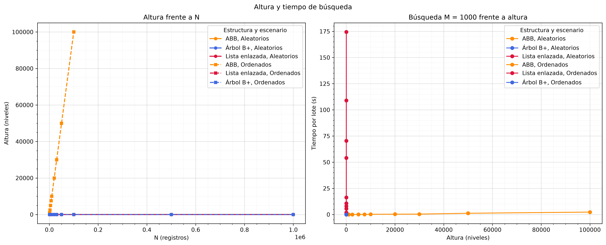

# Laboratorio 3: estructuras de datos y búsqueda de estudiantes

## Problema y objetivo

El laboratorio compara cómo se comportan tres estructuras al guardar registros
de estudiantes y buscar por ID. El problema es determinar cómo influyen el
tamaño de los datos y el orden de inserción en los tiempos, la altura, el
recorrido y el uso de memoria.

El objetivo es medir, bajo las mismas cargas, una lista enlazada, un árbol
binario de búsqueda sin balanceo (ABB) y un árbol B+. Se consideran inserciones
con IDs aleatorios y en orden ascendente, lotes de búsquedas existentes,
búsquedas inexistentes, listado, altura, memoria y consultas por rango.

## Terminología y estructuras

- **N**: cantidad de registros.
- **M**: cantidad de búsquedas por lote. No es el orden del árbol.
- **K**: cantidad de repeticiones independientes que indica el CSV para cada
  configuración.
- **Orden del B+**: el benchmark principal usa orden **16**. El barrido
  adicional compara los órdenes **4, 16 y 64**.
- **Modo**: orden de inserción de los IDs; no es el orden de las consultas.

| Estructura | Inserción individual | Construcción | Búsqueda | Recorrido ordenado |
| --- | --- | --- | --- | --- |
| Lista enlazada | \(O(1)\) al final | \(O(N)\) | \(O(N)\) | \(O(N\log N)\) con `listar()` |
| ABB, caso equilibrado | \(O(\log N)\) | \(O(N\log N)\) | \(O(\log N)\) | \(O(N)\) |
| ABB, IDs ordenados | hasta \(O(N)\) | \(O(N^2)\) | hasta \(O(N)\) | \(O(N)\) |
| Árbol B+, orden fijo 16 | \(O(\log N)\) | \(O(N\log N)\) | \(O(\log N)\) | \(O(N)\) |

El ABB no se balancea automáticamente: con IDs ascendentes puede degenerar en
una cadena. La complejidad equilibrada del ABB describe el caso promedio, no
una garantía del código. El árbol B+ mantiene una estructura multinivel y
enlaza sus hojas para recorrerlas en orden.

## Hardware y software

Datos leídos de [`resultados/ficha.json`](resultados/ficha.json):

### Ficha Técnica del Entorno de Experimentación

| Propiedad | Valor Registrado |
| :--- | :--- |
| **Procesador (CPU)** | 13th Gen Intel(R) Core(TM) i5-13420H |
| **Núcleos Lógicos** | 12 |
| **Memoria RAM** | 15.71 GB (16,869,351,424 bytes) |
| **Sistema Operativo** | Windows 11 (build 26200) |
| **Entorno Python** | CPython 3.11.9 (64-bit) |
| **Librerías Clave** | NumPy 2.4.6 \| pandas 3.0.6 \| Matplotlib 3.11.2 \| Seaborn 0.13.2 |
| **Semilla Aleatoria** | 2026 |
| **Fecha de Registro** | 2026-10-12 02:48:00 |

## Parámetros y límites de viabilidad

El conjunto de tamaños configurado es
\(N \in \{1.000,\ 2.500,\ 5.000,\ 7.500,\ 10.000,\ 20.000,\ 30.000,\ 50.000,\ 100.000,\ 500.000,\ 1.000.000\}\).
Los lotes de búsqueda son
\(M \in \{10,\ 100,\ 1.000,\ 10.000\}\). Estos tamaños y lotes aparecen en los
CSV de resultados.

El CSV registra \(K=10\) hasta \(N=10.000\), \(K=5\) para los tamaños
intermedios y \(K=3\) para los tamaños mayores. Para el ABB ordenado en el
límite \(N=100.000\) y en los puntos intermedios \(N \in
\{20.000,\ 30.000,\ 50.000\}\), registra \(K=3\). La lista enlazada para
\(N \ge 100.000\) usa \(K=3\) y limita las búsquedas existentes a
\(M \in \{10,\ 100,\ 1.000\}\). Se reduce el número de repeticiones en las
configuraciones costosas para contener el tiempo de ejecución; el ABB
ordenado puede requerir \(O(N^2)\) operaciones.

Límites del benchmark:

- ABB con IDs ordenados: viable solo hasta \(N=100.000\). Aun dentro de ese
  límite, una configuración puede superar el timeout y quedar como **no
  medido**, como ocurrió en los resultados de ese tamaño.
- Lista enlazada con \(N \ge 100.000\): búsquedas existentes limitadas a
  \(M \in \{10,\ 100,\ 1.000\}\). Para los tamaños grandes, las pruebas de
  memoria se reservan al árbol B+ y al ABB con IDs aleatorios.
- Cada operación (acumulada entre sus repeticiones \(K\)) tiene un timeout
  independiente de 600 segundos. Para el ABB
  ordenado en los tamaños intermedios \(20.000,\ 30.000,\ 50.000\), el límite
  es de 1.200 segundos por operación. Si una operación excede su límite, se
  marca como **no medido** y las demás operaciones continúan.
- `--reanudar` lee `resultados/resultados_benchmark.csv` y omite las
  combinaciones que ya estén en estado **medido**, sin omitir los demás
  experimentos de ese tamaño \(N\).

## Generación de datos y búsquedas

Para cada tamaño se generan IDs en orden ascendente o en una permutación
aleatoria. Los registros comparten los mismos campos y las búsquedas existentes
usan IDs aleatorios del conjunto generado. Las consultas se ejecutan en lotes
de tamaño M. Las búsquedas inexistentes usan IDs fuera del intervalo de IDs
almacenados.

La construcción y validación preceden al cronómetro de las operaciones de
búsqueda, listado, altura y rango. Se comprueba que `listar()` devuelve los IDs
en orden y que las consultas de validación encuentran los registros esperados.
La memoria se mide aparte durante una construcción; no se repite por cada K.

## Método de medición, estadística y atípicos

- Se usa `time.perf_counter()` y se desactiva temporalmente el recolector de
  basura durante la ventana cronometrada.
- Las operaciones rápidas se repiten dentro de una ventana para obtener su
  tiempo medio. Los CSV crudos registran la muestra, la duración de la ventana
  y el número de repeticiones internas.
- La memoria es el pico de asignaciones Python observado con `tracemalloc` y se
  expresa en bytes. No equivale al uso total de memoria del proceso.
- El resumen calcula media, desviación estándar muestral e intervalo de
  confianza del 95%. Detecta atípicos con la regla IQR, pero no los elimina de
  la media principal; también guarda la media sin atípicos.
- **No medido** significa que no existe una medición válida para esa
  configuración. No se interpreta como cero ni como una estimación.

## Resultados reales

Las siguientes cifras son medias y desviaciones muestrales del archivo
[`resultados/resultados_benchmark.csv`](resultados/resultados_benchmark.csv).
Los tiempos están en segundos; las búsquedas mostradas son lotes completos.
La altura es el promedio registrado y la memoria está en bytes. «no medido»
indica que el CSV no contiene una medición válida.

### N = 10.000

| Modo | Estructura | K | Inserción (s) | Búsqueda Q=1.000 (s) | Búsqueda Q=10.000 (s) | Listar (s) | Altura | Memoria (bytes) |
| --- | --- | ---: | ---: | ---: | ---: | ---: | ---: | ---: |
| IDs aleatorios | Lista enlazada | 10 | 0.00647273 ± 0.000152 | 1.2508 ± 0.0487 | 12.6555 ± 0.398 | 0.00375549 ± 9.78e-05 | 1 | 880,208 |
| IDs aleatorios | ABB | 10 | 0.019769 ± 0.000387 | 0.00148077 ± 4.3e-05 | 0.0155815 ± 0.000442 | 0.00261959 ± 0.000123 | 31.1 | 1,040,200 |
| IDs aleatorios | Árbol B+ | 10 | 0.0246819 ± 0.00032 | 0.000925313 ± 1.72e-05 | 0.00976259 ± 0.000115 | 0.000142369 ± 5.1e-06 | 4 | 522,928 |
| IDs ordenados | Lista enlazada | 10 | 0.00634033 ± 0.000251 | 1.17252 ± 0.0671 | 11.7782 ± 0.625 | 0.00239553 ± 0.00013 | 1 | 880,208 |
| IDs ordenados | ABB | 10 | 2.86638 ± 0.0609 | 0.234224 ± 0.00413 | 2.33729 ± 0.0512 | 0.00360591 ± 0.000137 | 10,000 | 1,040,416 |
| IDs ordenados | Árbol B+ | 10 | 0.0225913 ± 0.000562 | 0.000998411 ± 2.64e-05 | 0.0104341 ± 0.000196 | 0.000144656 ± 3.97e-06 | 5 | 637,384 |

### N = 100.000

| Modo | Estructura | K | Inserción (s) | Búsqueda Q=1.000 (s) | Búsqueda Q=10.000 (s) | Listar (s) | Altura | Memoria (bytes) |
| --- | --- | ---: | ---: | ---: | ---: | ---: | ---: | ---: |
| IDs aleatorios | Lista enlazada | 3 | 0.0712782 ± 0.000901 | 16.3536 ± 0.471 | no medido | 0.0452785 ± 0.000355 | 1 | 8,800,296 |
| IDs aleatorios | ABB | 5 | 0.384479 ± 0.00343 | 0.00323548 ± 4.75e-05 | 0.0330151 ± 0.000473 | 0.0480404 ± 0.00186 | 40.6 | 10,400,400 |
| IDs aleatorios | Árbol B+ | 5 | 0.282561 ± 0.102 | 0.00136585 ± 0.000673 | 0.0155792 ± 0.00627 | 0.0055668 ± 0.00205 | 5 | 5,253,368 |
| IDs ordenados | Lista enlazada | 3 | 0.0616533 ± 0.000959 | 10.703 ± 0.22 | no medido | 0.0226536 ± 0.0001 | 1 | 8,800,280 |
| IDs ordenados | ABB | 3 | 286.352 ± 0.542 | 2.33367 ± 0.0113 | 23.6604 ± 0.229 | 0.0386528 ± 0.00358 | 100,000 | 10,400,416 |
| IDs ordenados | Árbol B+ | 5 | 0.191815 ± 0.0708 | 0.00127231 ± 0.000576 | 0.0143083 ± 0.00506 | 0.00278327 ± 0.000793 | 6 | 6,411,952 |

### N = 1.000.000

| Modo | Estructura | K | Inserción (s) | Búsqueda Q=1.000 (s) | Búsqueda Q=10.000 (s) | Listar (s) | Altura | Memoria (bytes) |
| --- | --- | ---: | ---: | ---: | ---: | ---: | ---: | ---: |
| IDs aleatorios | Lista enlazada | 3 | 0.742227 ± 0.0135 | 174.393 ± 3.66 | no medido | 0.668503 ± 0.0189 | 1 | no medido |
| IDs aleatorios | ABB | 3 | 6.5557 ± 0.255 | 0.00591868 ± 0.000396 | 0.0580102 ± 0.00323 | 0.671762 ± 0.15 | 49.333 | 104,000,416 |
| IDs aleatorios | Árbol B+ | 3 | 5.70071 ± 0.0167 | 0.0038474 ± 0.000105 | 0.0384868 ± 0.00149 | 0.101907 ± 0.00574 | 6 | 52,605,656 |
| IDs ordenados | Lista enlazada | 3 | 0.630137 ± 0.0108 | 108.993 ± 0.547 | no medido | 0.237181 ± 0.00227 | 1 | no medido |
| IDs ordenados | ABB | 3 | no medido | no medido | no medido | no medido | no medido | no medido |
| IDs ordenados | Árbol B+ | 3 | 2.94219 ± 0.0385 | 0.00297675 ± 2.5e-05 | 0.0299357 ± 0.000221 | 0.0391671 ± 0.00267 | 7 | 64,159,184 |

Los registros de orden B+ distintos al orden 16 pertenecen al barrido
adicional. Los resultados adicionales, incluidos búsquedas inexistentes,
rangos y desviaciones, están en el CSV de resumen; cada medición individual
está en [`resultados/resultados_crudos.csv`](resultados/resultados_crudos.csv).
El listado de resultados por tamaño se encuentra en
[`resultados/tabla_N.md`](resultados/tabla_N.md).

## Tablas y gráficas

### Matriz comparativa


### Búsquedas por lote


### Inserción y extrapolación


El gráfico de extrapolación distingue sus proyecciones de los puntos medidos.
Una proyección no es un resultado de ejecución: su valor es **no medido** en
los CSV. La tabla anterior reporta para el tamaño mayor solamente las
configuraciones que sí están registradas como medidas.

### Altura, listado, memoria y orden B+




## Preguntas de Evaluación y Sustentación (Respuestas Empíricas)

Las cifras siguientes provienen de filas con estado `medido` en
[`resultados/resultados_benchmark.csv`](resultados/resultados_benchmark.csv).
Los tiempos se expresan en segundos. La memoria en MiB se calcula como bytes
divididos por 1.048.576. Se reportan promedios; una tendencia observada es
evidencia experimental, no una demostración de complejidad teórica.

### 1. ¿El comportamiento observado concuerda con las complejidades teóricas esperadas?

**En general, las tendencias medidas son compatibles con las esperadas, aunque los datos por sí solos no prueban una complejidad asintótica.**
***Lista enlazada:** La inserción registrada pasa de **0,0065 s** en
  $N=10.000$ a **0,7422 s** en $N=1.000.000$. Para $N=10.000$, los tiempos de
  búsqueda al variar el lote $Q$ de 10, 100, 1.000 y 10.000 son **0,0130**,
  **0,1277**, **1,2508** y **12,6555 s**. El ajuste lineal del tiempo frente a
  $Q$ para esos cuatro puntos tiene $R^2 = 0,9999985$.
***ABB con IDs ordenados:** La inserción toma **2,8664 s** en $N=10.000$,
  **71,7215 s** en $N=50.000$ y **286,3523 s** en $N=100.000$, patrón
  compatible con la degradación cuadrática de un ABB no balanceado. El CSV
  también contiene una ejecución separada no medida por timeout en $N=100.000$;
  no se usa como tiempo ni se confunde con el registro medido.
***Árbol B+ de orden 16:** Para $Q=10.000$, las búsquedas toman **0,0098 s**
  en $N=10.000$, **0,0156 s** en $N=100.000$ y **0,0385 s** en $N=1.000.000$,
  una tendencia compatible con el crecimiento logarítmico esperado.

### 2. ¿A partir de qué tamaño de entrada ($N$) se vuelven críticas las diferencias de rendimiento?

No hay un umbral único aplicable a todas las operaciones. En la inserción del
ABB con IDs ordenados, el tiempo medido crece desde **0,0916 s** en $N=2.500$
a **0,3626 s** en $N=5.000$ y **2,8664 s** en $N=10.000$. En este último
tamaño, buscar $Q=10.000$ IDs tarda **12,6555 s** en la lista enlazada y
**0,0098 s** en el B+ de orden 16. Así, las diferencias ya son visibles en
$N=5.000$ para inserción del ABB ordenado y resultan marcadas a $N=10.000$ en
las operaciones citadas.

### 3. ¿Existen costos constantes (*overhead*) que hagan que una estructura teóricamente más lenta supere a una más rápida en $N$ pequeño?

**Sí, las mediciones muestran una ventaja del ABB aleatorio en la inserción de $N=10.000$.**
*En $N=10.000$: ABB aleatorio **0,0198 s** frente a B+ de orden 16
  **0,0247 s**.
*En $N=100.000$: ABB aleatorio **0,3845 s** frente a B+ de orden 16
  **0,2826 s**.

La comparación documenta el cambio en esos tamaños; los tiempos del CSV no
aislan ni identifican por sí mismos la causa interna de la diferencia.

### 4. ¿Cómo impacta el orden de llegada de los datos (ordenados vs. aleatorios) a cada estructura?

***Lista enlazada:** Para inserción en $N=10.000$, se midieron **0,0065 s**
  con IDs aleatorios y **0,0063 s** con IDs ordenados.
***ABB:** Es muy sensible al orden. En $N=10.000$, el tiempo de inserción
  aumenta de **0,0198 s** con IDs aleatorios a **2,8664 s** con IDs ordenados.
  En $N=100.000$, los registros medidos son **0,3845 s** con IDs aleatorios y
  **286,3523 s** con IDs ordenados.
***Árbol B+ de orden 16:** En $N=100.000$, la inserción medida tarda
  **0,2826 s** con IDs aleatorios y **0,1918 s** con IDs ordenados. En esta
  configuración, la entrada ordenada fue más rápida; es una observación de
  estos datos, no una garantía para cualquier entrada.

### 5. ¿Qué estructura ofrece la mejor relación entre consumo de memoria y tiempo de respuesta en volúmenes masivos ($N = 1.000.000$)?

Entre las estructuras con resultados medidos en $N=1.000.000$ e IDs aleatorios,
el **Árbol B+ de orden 16** registra menor memoria y menor tiempo de búsqueda
que el ABB:
***Búsqueda de $Q=10.000$:** B+ **0,0385 s**; ABB **0,0580 s**.
***Memoria promedio:** B+ **50,17 MiB** (**52.605.656 bytes**); ABB
  **99,18 MiB** (**104.000.416 bytes**). El B+ usa aproximadamente **49,4 %**
  menos memoria según estos registros.

La memoria de la lista enlazada y su búsqueda con $Q=10.000$ en ese tamaño
figuran como **no medido**, por lo que no se incluyen en esta comparación.

### 6. ¿Cómo escala el costo de consultas masivas al variar el tamaño del lote ($Q$)?

Con $N=10.000$ e IDs aleatorios, al aumentar $Q$ de 1.000 a 10.000:
***Lista enlazada:** el tiempo pasa de **1,2508 s** a **12,6555 s**
  (aproximadamente **10,12 veces**).
***Árbol B+ de orden 16:** pasa de **0,0009 s** a **0,0098 s**
  (aproximadamente **10,55 veces**).

En ambos casos, el tiempo medido crece aproximadamente en proporción al lote
en este rango. Para el B+ con $Q=10.000$, al variar $N$ de 10.000 a 100.000 y
1.000.000, los tiempos registrados son **0,0098**, **0,0156** y **0,0385 s**.

### 7. ¿Cuál es el impacto del grado o capacidad del nodo ($M$) en la estructura del Árbol B+?

Para $N=100.000$ e IDs aleatorios, los promedios medidos según el orden del
nodo B+ son:

| Orden del nodo | Altura promedio | Inserción (s) | Memoria promedio (bytes) | Memoria (MiB) |
| :---: | :---: | :---: | :---: | :---: |
| 4 | 13,8 | 0,4915 | 29.306.016 | 27,95 |
| 16 | 5,0 | 0,2826 | 5.253.368 | 5,01 |
| 64 | 3,2 | 0,1344 | 2.491.296 | 2,38 |

En estas mediciones, al aumentar el orden de 4 a 64 disminuyen la altura
promedio, el tiempo de inserción y la memoria registrada.

## Limitaciones

- Los resultados dependen del equipo, el intérprete y la carga del sistema
  registrados en `ficha.json`.
- Las configuraciones abortadas por timeout o excluidas por viabilidad no
  ofrecen una base para comparar tiempos, alturas o memoria; se muestran como
  **no medido**.
- La memoria de `tracemalloc` corresponde a asignaciones trazadas por Python,
  no a toda la memoria residente del proceso.
- Las proyecciones de la figura de extrapolación son estimaciones gráficas y no
  forman parte de los valores medidos de los CSV.
- El enunciado original con las siete preguntas no está guardado en los
  archivos de resultados; las respuestas de esta sección se limitan a
  conclusiones respaldadas por el CSV.

## Cómo reproducir

Desde la raíz del repositorio, configure el entorno e instale las dependencias:

```powershell
py -3.11 -m venv .venv
.\.venv\Scripts\Activate.ps1
python -m pip install -r requirements.txt
```

Ejecute el benchmark reducido o completo:

```powershell
python main.py --rapido
python main.py
```

Para continuar una corrida usando los tamaños ya guardados en el CSV crudo:

```powershell
python main.py --reanudar
```

Para regenerar las figuras desde los resultados existentes sin volver a medir:

```powershell
python main.py --solo-graficas
```

Los CSV parciales se escriben al terminar cada N. Revise
`resultados/resultados_crudos.csv`, `resultados/resultados_benchmark.csv`,
`resultados/tabla_N.md`, `resultados/ficha.json` y los PNG de `graficas/`.
